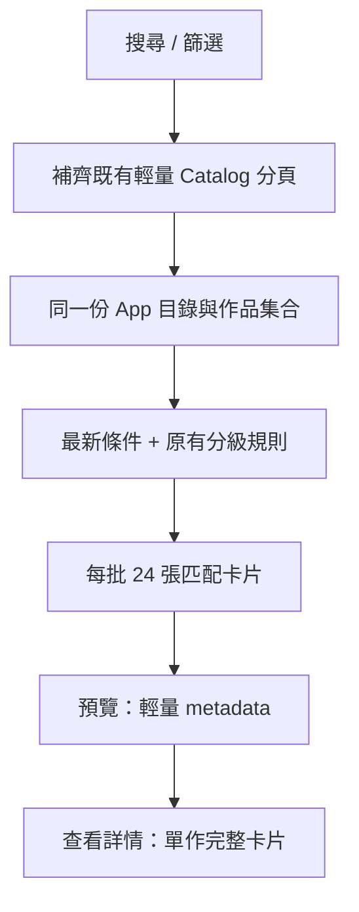

# Explore 完整目錄搜尋與漸進呈現

## 基準與根因

開發基準 main `f6d8983c0f9196f4b912c498f56eb09e4195798c`。GitHub 已確認 #958 於台灣時間 2026-11-14 22:14、#959 於 22:25 合併；本次不更動兩案 CSS。

`App.loadCharacters()` 同時取得 `data/characters.json` 與社群 manifest。官方目錄 29 筆，社群兩頁 48／9 筆；初始只抓最新的第二頁。原始條目共 86 筆，沿用 ID 去重後共 75 部作品。成人內容預設隱藏，因此正式初始畫面可見 24 部。分頁不是 24 筆；24 是可見作品數。

社群 manifest 只有頁面路徑及數量，沒有完整標題索引。各目錄分頁本身已包含標題、名稱、短簡介、標籤、作者、分級、discovery 分類、能力與版本時間；不包含世界書、完整角色設定或作者 HTML。

原資料流：

`explore-discovery.js` 的 `currentMatches()` 只篩選 `App.characters`；`character-ui.js` 也只替這些作品建立卡片。「未讀餘溫」位於第一頁，故初次搜尋 0 筆，手動載入更多才變 1 筆。另發現舊 `loadMoreCharacters()` 在請求成功前已遞減游標，失敗重試會略過原頁。

## 採用方案

搜尋、分類、能力、收藏、最近看過、更新或非預設排序首次使用時，以 manifest 的有限頁面列表循序補齊既有輕量目錄；初始一般瀏覽仍只抓原本三份目錄資源。所有補頁沿用 `loadMoreCharacters()`、`mergeCharacterCatalog()`，共用 in-flight promise，成功後才提交游標。成功載入的分頁不重抓；失敗停止並提供重試，不背景無限重試。

不建立第二份持久搜尋索引、不加後端。查詢回應只補充共同目錄，不保存舊查詢結果；每次顯示依最新篩選狀態計算，因此較慢的請求不會恢復舊關鍵字。每次篩選建立短期 Map／Set 查找作者、收藏與最近看過，避免每筆作品重掃 manifest 及反覆正規化 60 筆瀏覽紀錄。

`character-ui.js` 使用 discovery 提供的同一批匹配作品，以 24 張為一批建立卡片；清除／切換條件回到首批，「載入更多」增加目前結果的呈現額度。此暫態視窗不另存作品、不改存檔 schema。預覽仍讀輕量資料，查看詳情才經 `App.loadCharacter()` 下載該作完整卡片。

| 方案 | 效能／一致性／成本 | 決定 |
| --- | --- | --- |
| 按需補齊現有輕量分頁 | 現況首次搜尋多 1 次約 67 KB；沿用發布與去重契約，不多一份同步來源 | 採用 |
| 新增獨立靜態全文索引 | 可減少分頁抓取，但需串接官方／社群發布、版本更新與撤下流程，否則容易不同步 | 目前不採用 |
| 每次輸入逐頁遠端搜尋 | 重複請求、結果競態與長尾延遲增加，既有靜態主機也無搜尋端點 | 不採用 |
| 一次下載所有完整角色卡 | 圖片／世界書／作者內容流量與解析成本遠高於 metadata | 不採用 |
| 只修改空狀態文字 | 無法解決玩家找不到已公開作品 | 不作為完成方案 |

## 操作與可見性

- 載入中顯示「正在搜尋完整作品目錄」，不把尚未完成的搜尋顯示成真正無結果。
- 社群 manifest／任一分頁／官方目錄失敗皆保留可重試狀態。部分結果明示只搜尋已載入作品，提供完整搜尋重試。
- 完整後分開報告匹配總數及目前呈現數量；收藏、最近看過及版本標記仍使用既有 localStorage 與 publication metadata。
- 成人顯示沿用 `BAOContentPreferences.canExpose`、`isDiscoveryAdult` 與 discovery rating；查詢不繞過設定，也不新增成人同意機制。
- 公開探索的來源仍只限正式目錄；不讀作者提交佇列、草稿或作者私人工作區，也不掃描 `data/characters/` 目錄。私人／未發布檔案不會因其存在於其他位置而進入搜尋。本機匯入作品維持原本的本機可見行為，並非公開發布。
- `github-publication-transport.js` 的發布流程原本就將經審核 metadata／版本寫入官方或社群目錄的 review PR；本案沒有修改此邊界。這不是伺服器授權或撤下即時性的新保證；既有 cache／同一分頁 session 的更新策略不變。

## 量測與驗證

配對 E2E 以同一候選頁面和資源環境，分別載入基準 commit 的三份 runtime JS 與候選 JS，驗證搜尋結果、DOM、網路請求與鍵盤操作；不是兩個任意不同時期站點的比較。320／390／1280px 都包含。瀏覽器時間採 Playwright 操作到可見斷言的 wall-clock，含排程與瀏覽器通訊，不能解讀為單純演算法時間或真實手機速度。

網路負載可直接從固定版本檔案重現：初始 `characters.json` 38,390 B + manifest 302 B + 第二頁 11,646 B = 50,338 B／3 次請求；首次完整搜尋補第一頁 66,799 B／1 次；合計 117,137 B／4 次。後續搜尋不再請求目錄；搜尋及預覽完整卡片下載數為 0。這些是未壓縮回應 body bytes，不是包含 HTTP 標頭或 CDN 壓縮的傳輸封包量。

CPU／記憶體擴充測試由 `node --expose-gc scripts/benchmark-explore-search.cjs` 重現，直接擷取修改前後 `currentMatches()` 執行。75／1,000／5,000 部合成 metadata、最多 60 筆最近瀏覽與 100 筆收藏、關鍵字加更新排序，各 7 次 warm samples。數據另見 `explore-search-benchmark.json`。GC 後 retained delta 有噪音，不能當成 peak heap 或記憶體洩漏證明。

同一 runtime `c579c1f` 的配對搜尋情境已在三瀏覽器通過。下列為各 viewport 單次樣本，前後值皆為 ms；修改前的首次搜尋雖較快結束，結果錯為 0，修改後為正確 1。此 run 尚有一項成人分批呈現測試需更新，不能將該 workflow 整體稱為通過。最終通過狀態另見 PR #960。

| 瀏覽器／寬度 | 首頁至列表可操作 前→後 | 首次搜尋 前→後 | 後續搜尋 前→後 |
| --- | ---: | ---: | ---: |
| Chromium 320 | 3173→2151 | 127→260 | 240→56 |
| Chromium 390 | 2500→3022 | 126→188 | 253→72 |
| Chromium 1280 | 2407→2120 | 92→401 | 194→163 |
| Firefox 320 | 3389→1264 | 124→130 | 173→89 |
| Firefox 390 | 1252→1219 | 69→119 | 49→79 |
| Firefox 1280 | 1778→1602 | 145→231 | 133→74 |
| WebKit 320 | 5596→3123 | 1101→667 | 367→74 |
| WebKit 390 | 3607→2950 | 162→350 | 649→88 |
| WebKit 1280 | 3513→2780 | 231→852 | 336→167 |

不能由這些單次共享 runner 樣本宣稱首屏一定加速；初始請求與 body bytes 保持相同。前後各情境均驗證初始可見 24 張、無水平溢出、搜尋與預覽完整卡片請求為 0。原始 JSON／截圖見 [配對 Actions](https://github.com/ghost80076-cmyk/bao-lab/actions/runs/43606991428)。

| 合成作品數 | 篩選＋排序 p50 前→後（ms） | 合成目錄 retained heap | 合成 JSON bytes |
| --- | ---: | ---: | ---: |
| 75 | 6.042→2.847 | 262,624 B | 82,425 B |
| 1,000 | 239.537→38.005 | 3,307,512 B | 1,098,424 B |
| 5,000 | 4804.140→193.108 | 16,601,312 B | 5,504,763 B |

這是 Node v24.22.1、VM 中抽取的 filter 實作，不含 DOM／網路；合成目錄 heap 為複製獨立 metadata 後 GC 的差值，不是整站 peak。Chromium 對應頁面 coarse heap 採樣約 11.2–13.4 MB，Firefox／WebKit 不提供此 API。不能依此證明沒有洩漏或推論實機總記憶體。

本機完整 Core workflow、目錄 runtime 6 tests、Explore／catalog metadata Core 通過；遠端 `c579c1f` Core、Maintenance、Regression Gate 已通過。三瀏覽器完整最終結果以 PR #960 Checks／交付說明為準；不把失敗、略過或 pending 視為通過。測試不呼叫真實 Provider，不消耗模型 Token。

## 影響與剩餘限制

執行期修改為 `js/app.js` 既有目錄方法、`js/explore-discovery.js` 篩選與呈現視窗、`js/character-ui.js` 卡片來源／分批操作，`index.html` 更新三份 JS 的 cache version。Core／E2E、單一專用三瀏覽器 workflow、benchmark 與本文件提供驗證；既有前端 loader 測試同步版本斷言。沒有修改 Story Engine、記憶、狀態、生成、API/provider 路由、錢包、作者作品或持久存檔格式。

大量作品時仍須一次取得所有可探索輕量分頁；目前只有兩頁。CPU 查詢仍線性掃描 metadata，排序為 O(n log n)，不是無限擴充的服務端搜尋。5,000 部合成作品的結果不代表 5,000 部真實作品的下載／圖片或實機體驗，若規模到達此等級需另訂預算與索引策略。

viewport 測試不是實體 Android／iOS、軟鍵盤、行動網路、耗電與溫度驗證。回退為 revert 本 PR runtime 與載入版本，無資料遷移；保留既有收藏與最近看過資料。不合併、不部署。
